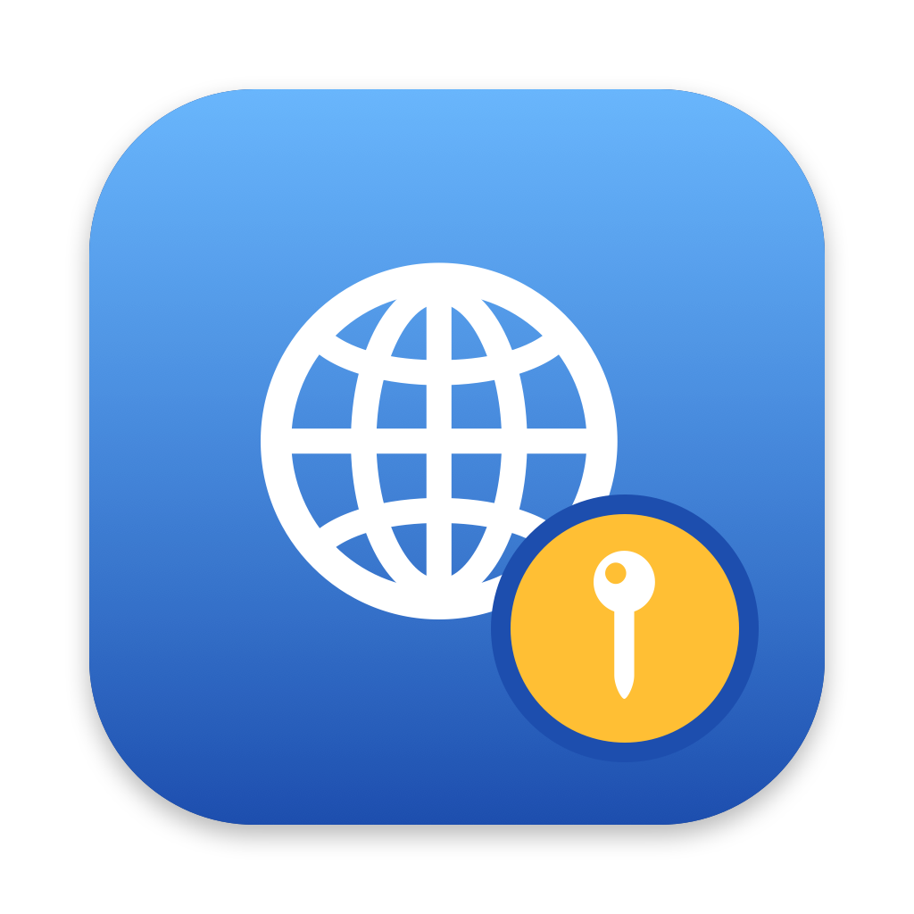
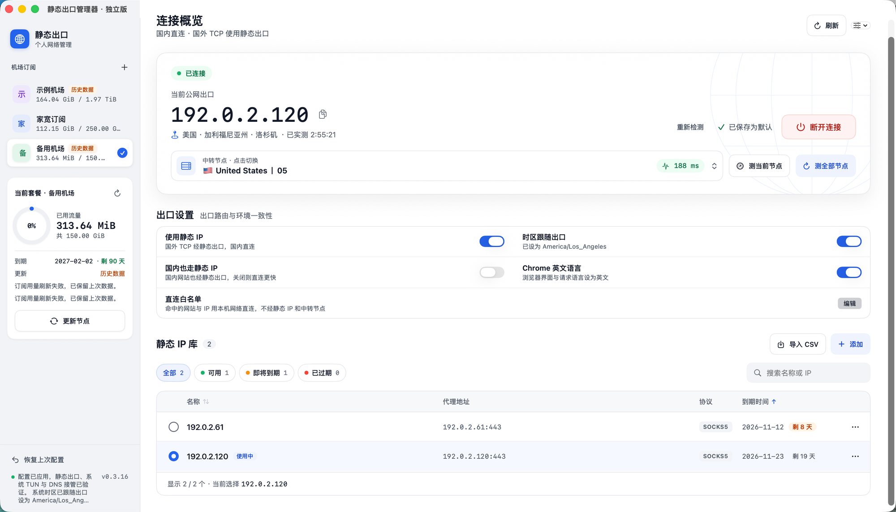

  

<h1 align="center">Static Exit Manager</h1>

<a href="README.md">中文</a> | <b>English</b>

A static-IP exit manager for macOS: domestic (China) traffic goes direct, while overseas traffic is relayed through your proxy subscription and exits from your own static IP. Ships with a built-in Mihomo core. No Clash Verge required.

  <a href="../../releases/latest"><b>⬇ Download the latest release</b></a>

## Screenshot

> Subscription names and IP addresses in the screenshot are sample data. The app UI is in Chinese.

## What it does

Many services judge account risk by IP address, and switching IPs too often can trigger verification or even get accounts banned. Static Exit Manager keeps your overseas traffic leaving from the same static IP, without slowing down domestic sites:

- **Domestic traffic goes direct**: China sites and your LAN are not rerouted, so they stay fast.
- **Overseas traffic exits from your static IP**: overseas TCP traffic is relayed through a node from your subscription and leaves from your static IP (SOCKS5).
- **Verified exit**: every connection measures the real public exit IP and its location. The app shows "Connected" only after the static exit, the system TUN and DNS takeover have all been verified.

## Features

**Subscriptions and nodes**
- Accepts subscription URLs or Clash/Mihomo YAML files, and shows used traffic, total quota, expiry date and days remaining.
- Relay nodes are speed-tested in the background. You can test the current node or all nodes at once. Switching nodes while connected reconnects and re-verifies the exit automatically.
- Can import the subscriptions and static exit from an existing Clash Verge setup in one step.

**Static IP library**
- Manage multiple static IPs: import a provider CSV or add them by hand. Passwords are stored in the macOS Keychain.
- Filter and sort by available / expiring soon / expired, with days remaining shown before expiry.
- When no static IP is selected, you can connect through a relay node alone.

**Exit settings**
- **Route domestic traffic through the static IP too**: everything except local and LAN traffic exits from the static IP.
- **Time zone follows the exit**: while connected, the system time zone matches the exit IP's location, and is restored when you disconnect.
- **Chrome in English**: switches Chrome's interface language and the language it requests from websites to English. You can revert it at any time.
- **Direct-connection allowlist**: listed domains, IPs and apps (including all their helper processes) always use your local network directly. Changes take effect immediately.

**Hassle-free**
- Takes over system traffic and DNS only while connected, and fully restores them afterwards. Permanent system proxy and DNS settings are never changed.
- If a switch fails, the last working configuration is restored automatically.
- Built-in update check: download, verify and replace the app in one click.

## Requirements

- Mac with Apple Silicon (M-series chip)
- macOS 14 or later

Nothing else to install: no Python, Clash or other software is needed.

## Installation

1. Download `StaticExitManager-<version>-arm64.dmg` from [Releases](../../releases/latest).
2. Open the dmg and drag the app into Applications.
3. If macOS says the developer cannot be verified the first time you open it, go to System Settings → Privacy & Security and click "Open Anyway" near the bottom of the page.
4. In the app, click "安装网络服务" (Install Network Service) and enter your login password once.

## Usage

1. Turn off TUN mode and the system proxy in any other VPN first.
2. Add a subscription, or import your Clash Verge configuration.
3. Add a static IP, choose a relay node and click Connect.
4. Disconnect releases everything the app took over. Closing the window does not disconnect, and the app does not connect automatically after a restart.

## Privacy

- All data stays on your Mac, with no telemetry or cloud sync. Static IP passwords are stored in the macOS Keychain.
- To look up the exit location, the app sends only the public exit IP to [ipwho.is](https://ipwhois.io/). It never sends your subscriptions, accounts or passwords.

## Known limitations

- Overseas UDP and public IPv6 are blocked (except for allowlisted destinations) so they cannot bypass the static exit.
- Only Clash/Mihomo YAML subscriptions that contain a `proxies` list are supported.
- There is no kill switch if the connection drops.

## Third-party components

[Mihomo](https://github.com/MetaCubeX/mihomo) (GPL-3.0), [Python](https://www.python.org/) (PSF License), [PyYAML](https://github.com/yaml/pyyaml) (MIT).

## Disclaimer

This project is for learning and personal network management only. Please comply with the laws and regulations where you live.
