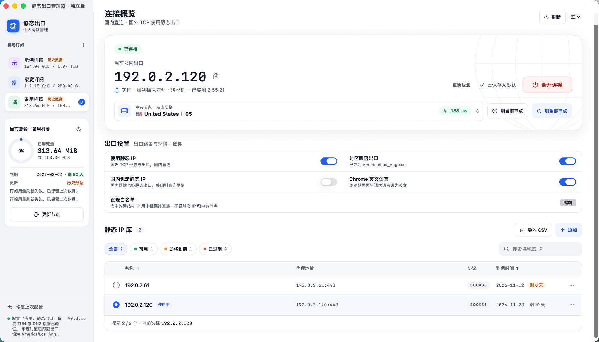

  

<h1 align="center">静态出口管理器</h1>

<b>中文</b> | <a href="README.en.md">English</a>

macOS 上的静态 IP 出口管理工具：国内直连，国外流量经机场中转、从你自己的静态 IP 出去。 内置 Mihomo 内核，开箱即用，不需要 Clash Verge。

  <a href="../../releases/latest"><b>⬇ 下载最新版本</b></a>

## 界面预览

> 截图中的订阅名称和 IP 均为示例数据。

## 它能做什么

很多服务会根据 IP 判断账号风险，频繁换 IP 容易触发验证甚至封号。静态出口管理器让你的海外流量始终从同一个静态 IP 出去，同时尽量不影响国内访问速度：

- **国内直连**：国内网站和局域网不绕路，速度不受影响。
- **国外经静态 IP**：国外 TCP 流量经机场节点中转，最终从你的静态 IP（SOCKS5）出去。
- **出口实测**：每次连接都实测公网出口 IP 和所在地点；静态出口、系统 TUN 和 DNS 接管都核实通过后，才显示「已连接」。

## 功能

**订阅与节点**
- 支持机场订阅链接或 Clash/Mihomo YAML，显示已用流量、套餐总量、到期日和剩余天数。
- 中转节点后台自动测速，可以测当前节点，也可以一键测全部节点；已连接时切换节点会自动重连，并重新验证出口。
- 可以一次性迁移本机 Clash Verge 的订阅和静态出口。

**静态 IP 库**
- 管理多个静态 IP，支持导入服务商 CSV 或手动添加，密码保存在 macOS 钥匙串里。
- 按「可用 / 即将到期 / 已过期」筛选和排序，到期前会提醒剩余天数。
- 不选静态 IP 时，也可以只用中转节点连接。

**出口设置**
- **国内也走静态 IP**：除本机和局域网以外，所有流量都经静态出口。
- **时区跟随出口**：连接期间系统时区自动设为出口 IP 所在地，断开后恢复。
- **Chrome 英文语言**：把 Chrome 的界面语言和网页请求语言切换为英文，可以随时还原。
- **直连白名单**：命中的域名、IP 或应用（含其全部子进程）始终用本机网络直连，修改后立即生效。

**省心**
- 连接期间临时接管系统流量和 DNS，断开后完全恢复，不改动永久的系统代理和 DNS 设置。
- 切换失败会自动恢复上一次可用的配置。
- 内置检查更新，一键下载、校验并替换应用。

## 系统要求

- Apple Silicon（M 系列芯片）Mac
- macOS 14 及以上

不需要另外安装 Python、Clash 或其他软件。

## 安装

1. 在 [Releases](../../releases/latest) 下载 `StaticExitManager-<版本>-arm64.dmg`。
2. 打开 dmg，把「静态出口管理器独立版」拖进「应用程序」。
3. 首次打开时，系统如果提示无法验证开发者，到「系统设置 → 隐私与安全性」，点页面下方的「仍要打开」。
4. 在应用里点「安装网络服务」，输入一次电脑登录密码。

## 使用

1. 先关闭其他 VPN 的 TUN 模式和系统代理。
2. 添加机场订阅，或迁移 Clash Verge 的配置。
3. 添加静态 IP，选好中转节点后点「连接」。
4. 「断开连接」会释放所有接管。关闭窗口不会断开连接；重启电脑后不会自动连接。

## 隐私

- 所有数据只保存在本机，没有遥测，也没有云同步；静态 IP 的密码存放在 macOS 钥匙串。
- 只有在查询出口地点时，才会把公网出口 IP 发给 [ipwho.is](https://ipwhois.io/)，不会发送订阅、账号或密码。

## 已知限制

- 国外 UDP 和公网 IPv6 会被拦截（直连白名单内的除外），防止绕过静态出口。
- 只支持带 `proxies` 列表的 Clash/Mihomo YAML 订阅。
- 不提供断线锁网。

## 第三方组件

[Mihomo](https://github.com/MetaCubeX/mihomo)（GPL-3.0）、[Python](https://www.python.org/)（PSF License）、[PyYAML](https://github.com/yaml/pyyaml)（MIT）。

## 免责声明

本项目仅供学习和个人网络管理使用，请遵守所在地的法律法规。
