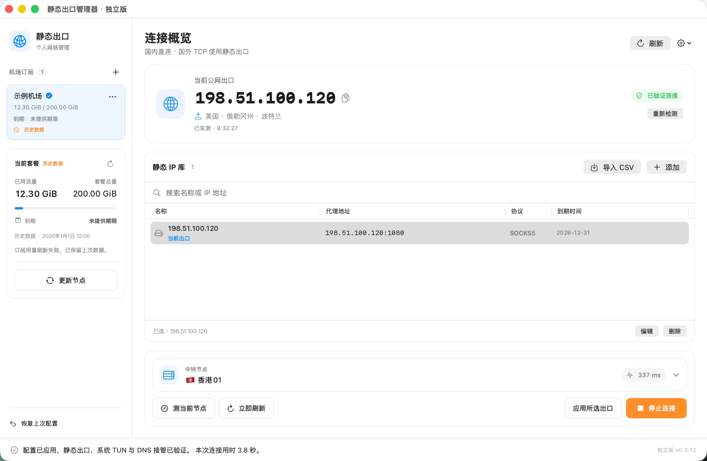

<p align="center">
  
</p>

<h1 align="center">静态出口管理器</h1>

<p align="center">macOS 上的静态 IP 出口管理工具：国内直连，国外 TCP 经机场中转连接你的静态出口。内置 Mihomo 内核，不需要 Clash Verge。</p>

<p align="center">
  <a href="../../releases/latest"><b>下载最新版本</b></a>
</p>

## 界面预览



- **左侧**：机场订阅列表与当前套餐的已用流量、总量和到期日；「更新节点」拉取最新节点配置。
- **当前公网出口**：连接后显示实测出口 IP 与所在地点，「已验证连接」表示静态出口、系统 TUN 和 DNS 接管均已核实。
- **静态 IP 库**：保存的静态 IP，可导入服务商 CSV 或手动添加，选中一条作为出口。
- **中转节点**：选择经由的机场节点并显示延迟；已连接时切换节点或静态 IP 会自动重连。
- **底部状态栏**：显示最近一次操作结果和连接耗时。

> 截图中的订阅、用量、IP 与地点均为示例数据。

## 功能

- 管理机场订阅（远程链接或 Clash/Mihomo YAML），显示已用流量、总量和到期日。
- 管理静态 IP（SOCKS5），密码保存在 macOS 钥匙串。
- 选择中转节点，后台每 10 分钟自动测速；已连接时切换节点或静态 IP 会自动重连并验证出口，失败自动恢复。
- TUN 模式接管系统流量：国内与局域网直连，国外 TCP 经“机场 → 静态 IP”出口，并显示实测公网出口 IP 与地点。
- 连接期间临时接管 DNS，停止后恢复；不修改永久系统代理与 DNS 设置。
- 可一次性迁移本机 Clash Verge 的订阅和静态出口。
- 未选择静态 IP 时，可只用中转节点连接。
- 启动时自动检查更新（每 24 小时最多一次），也可在设置菜单手动检查；一键下载、校验并替换应用。

## 系统要求

- Apple Silicon（M 系列芯片）Mac
- macOS 14 及以上

无需安装 Python、Ruby 或其他软件。

## 安装

1. 在 [Releases](../../releases/latest) 下载 `StaticExitManager-<版本>-arm64.dmg`。
2. 打开 dmg，把「静态出口管理器独立版」拖到「Applications（应用程序）」。
3. 打开应用。应用未经 Apple 公证，首次打开会提示无法验证开发者：
   前往「系统设置 → 隐私与安全性」，在页面下方点「仍要打开」。
4. 在应用中点「安装网络服务」，输入一次电脑登录密码。

## 使用

1. 先关闭其他 VPN 的 TUN 模式和系统代理。
2. 添加机场订阅链接、导入 YAML，或迁移 Clash Verge 配置。
3. 添加静态 IP，选择订阅、静态 IP 与中转节点，点「开始连接」。
4. 「停止连接」会退出内核并释放 TUN。关闭窗口不会断开连接；重启电脑后不会自动连接。

## 数据与隐私

| 内容 | 位置 |
|---|---|
| 静态 IP 信息 | `~/Library/Application Support/StaticExitManager/profiles.json` |
| 静态 IP 密码 | macOS 钥匙串 |
| 订阅、节点缓存、选择、备份、诊断日志 | `~/Library/Application Support/StaticExitManager/standalone/` |
| 网络服务与内核运行目录 | `/Library/Application Support/StaticExitManagerService/` |

- 所有数据只保存在本机，没有遥测或云同步。
- 连接成功后会把公网出口 IP 发送给 [ipwho.is](https://ipwhois.io/) 查询地点，不发送订阅、账号或密码。
- 出口检测访问 `1.1.1.1`、`1.0.0.1` 的 trace 页面，必要时访问 `api.ipify.org`、`icanhazip.com`。

## 工作方式

- **界面**（SwiftUI）以普通用户权限运行，调用应用内置的独立 Python 后台处理订阅、配置生成和出口检测。
- **网络服务**（`/Library/PrivilegedHelperTools/local.staticexit.network`）以 root 运行，只负责内置 Mihomo 内核的校验、启动、重载和停止。它只接受安装时的用户和这份应用的签名；重新安装或更新应用后，需要在应用中重新安装网络服务。
- 内核控制接口为 root 私有 Unix socket；HTTP/SOCKS 混合端口只监听 `127.0.0.1:17896`。

## 限制

- 国外 UDP 和未匹配直连规则的公网 IPv6 会被拒绝。
- 只支持包含 `proxies` 列表的 Clash/Mihomo YAML 订阅；暂不支持仅 `proxy-providers`、Base64 通用链接或需要插件的订阅。
- 不提供断线锁网。

## 从源码构建

```sh
uv python install 3.12   # 准备独立 Python（python-build-standalone）
./build.sh               # 构建并安装到 ~/Applications
./make_dmg.sh            # 生成 dist/StaticExitManager-<版本>-arm64.dmg
```

运行测试：

```sh
python3 -m unittest test_backend test_connection_parallel test_validation_cache test_exit_location
```

## 第三方组件

- [Mihomo](https://github.com/MetaCubeX/mihomo) v1.19.33（GPL-3.0），官方发布包校验值见 `vendor/manifest.json`，许可证见 `vendor/LICENSE-mihomo`
- [Python](https://www.python.org/) 3.12（PSF License），来自 [python-build-standalone](https://github.com/astral-sh/python-build-standalone)
- [PyYAML](https://github.com/yaml/pyyaml) 6.0.3（MIT），见 `vendor/pylib/LICENSE-pyyaml`

## 免责声明

本项目仅供学习与个人网络管理使用。请遵守所在地法律法规。
